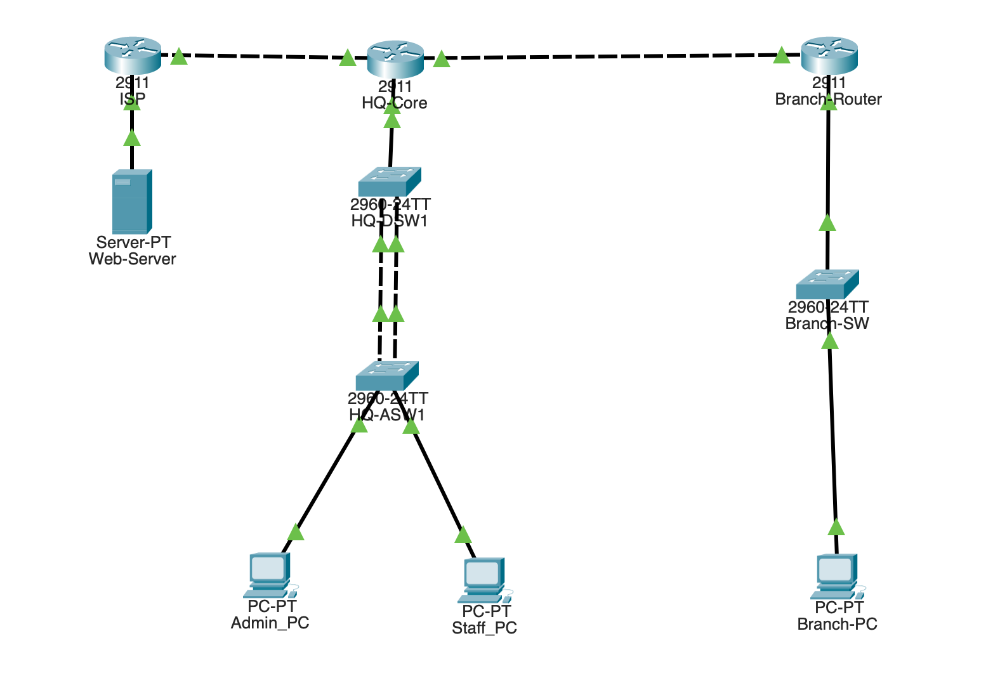

# Enterprise Multi-Site Network Architecture & Security Hardening

A simulated enterprise-grade campus and branch network built and validated in Cisco Packet Tracer. The project implements hierarchical network segmentation, dynamic routing across WAN links, centralized and localized DHCP services, perimeter Port Address Translation (PAT), and control-plane security hardening.

---

## 📌 Architecture Topology

### Key Network Segments
* **HQ Campus:**
  * **VLAN 10 (Staff):** `192.168.10.0/24` — User workstations and access endpoints
  * **VLAN 20 (Management):** `192.168.20.0/24` — Administrative jump hosts and management interfaces
  * **VLAN 99 (Native/Blackhole):** Tagged non-default native VLAN across all trunks
* **Branch Office:**
  * **VLAN 30 (Branch Staff):** `192.168.30.0/24` — Branch office endpoints
* **Point-to-Point WAN:** `10.0.0.0/30` — Routed link between `HQ-Core` and `Branch-Router`
* **Simulated ISP / Public Internet:** `203.0.113.0/30` edge link to public DNS server `8.8.8.8`

---

## ⚙️ Core Technical Implementations

### 1. Layer 2 Switching & Spanning Tree
* **VLAN Segmentation:** 802.1Q encapsulation trunking between access and distribution layers.
* **STP Hardening:** Deterministic Root Bridge placement via priority manipulation (`4096`), with `spanning-tree portfast` and `bpduguard enable` enforced on all host-facing ports to prevent rogue switch attachments and STP topology recalculations.

### 2. Layer 3 Routing & Scalability
* **Router-on-a-Stick (ROAS):** Subinterfaces on `HQ-Core` for inter-VLAN routing (`Gig0/0.10`, `Gig0/0.20`, `Gig0/0.99`).
* **OSPF Area 0:** Dynamic neighbor adjacency established between `HQ-Core` and `Branch-Router` across the WAN with passive-interface defaults on LAN subnets to reduce broadcast overhead.
* **Route Redistribution:** Static default routing redistributed into OSPF for seaml

### 3. IP Addressing Services (DHCP)
* **HQ Campus:** Centralized IOS DHCP server pools (`HQ_Staff_Pool`, `HQ_Admin_Pool`) configured directly on `HQ-Core` to dynamically serve campus VLANs, with static IP exclusion blocks reserved for network infrastructure and gateways.
* **Branch Office:** Localized DHCP pool (`Branch_Staff_Pool`) hosted directly on `Branch-Router` to handle local subnet leasing independently, ensuring site autonomy.

### 4. Security Hardening & Perimeter Defense
* **Inter-VLAN Extended ACLs:** Outbound filtering on `Gig0/0.20` preventing lateral movement from Staff (`VLAN 10`) and Branch (`VLAN 30`) to the Management subnet, while permitting stateful-style ICMP `echo-reply` return traffic for administrator diagnostics.
* **Management Plane Hardening:** Telnet disabled; SSHv2 enforced with RSA 1024-bit encryption, local database authentication (`login local`), and restricted VTY access via Standard ACL (`access-class 10`).
* **Edge NAT / PAT (Overload):** Dynamically translates internal RFC 1918 private subnets to public WAN interface `Gig0/2` (`203.0.113.2`) to allow outside internet reachability.

---

## 🧪 Verification & Audit Results

| Test Scenario | Source | Destination | Expected Result | Status |
|---|---|---|---|---|
| **Inter-VLAN Route** | Staff PC (`192.168.10.x`) | Branch PC (`192.168.30.x`) | Ping succeeds across OSPF WAN | ✅ Pass |
| **ACL Segmentation** | Staff PC (`192.168.10.x`) | Admin PC (`192.168.20.x`) | Dropped by ACL 101 | ✅ Pass |
| **Admin Inspection** | Admin PC (`192.168.20.x`) | Staff PC (`192.168.10.x`) | Ping succeeds (echo-reply permitted) | ✅ Pass |
| **Internet Access** | All Endpoints | Web Server (`8.8.8.8`) | HTTP loads / NAT translation active | ✅ Pass |
| **Control Plane SSH** | Staff PC (`192.168.10.x`) | HQ-Core (`192.168.10.1`) | Connection refused by VTY ACL | ✅ Pass |
| **Control Plane SSH** | Admin PC (`192.168.20.x`) | HQ-Core (`192.168.20.1`) | Authenticated SSH session established | ✅ Pass |

---

## 🛠️ Repository Contents
* `configs/`: Clean running configuration files exported from each network device (`.cfg`).
* `topology/`: Packet Tracer `.pkt` file for testing and live simulation.
